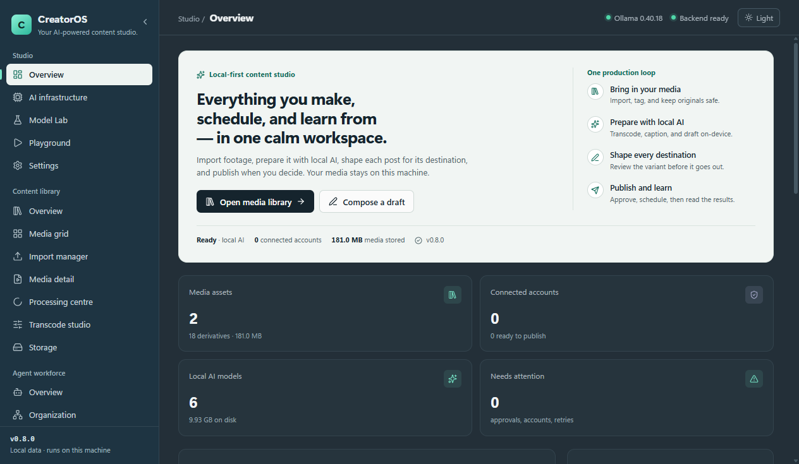
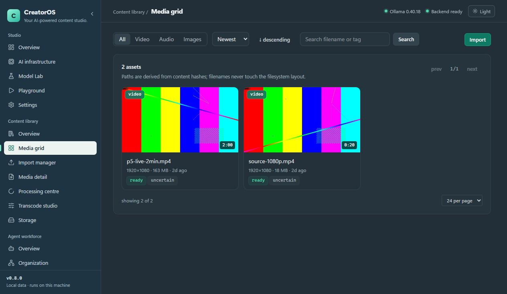
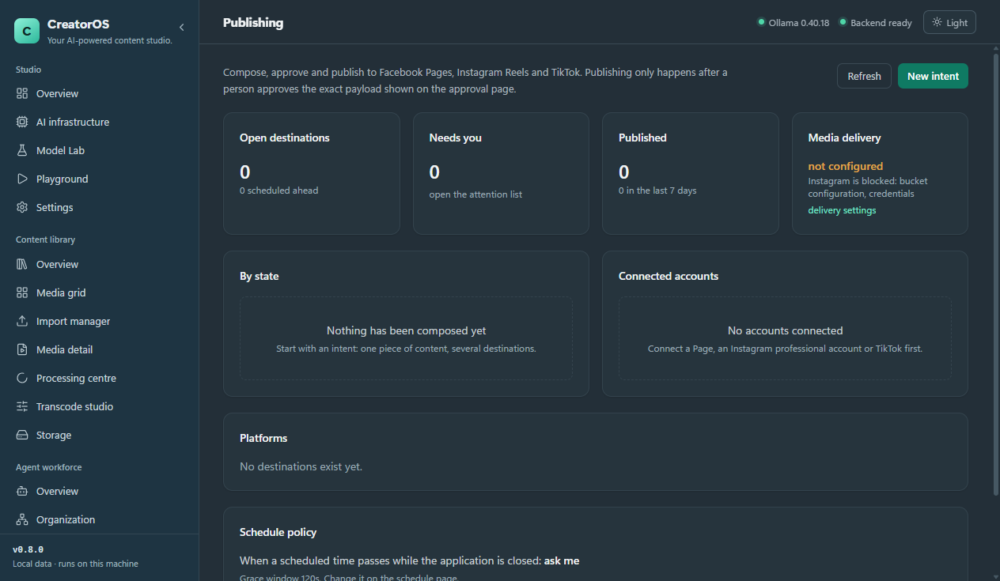
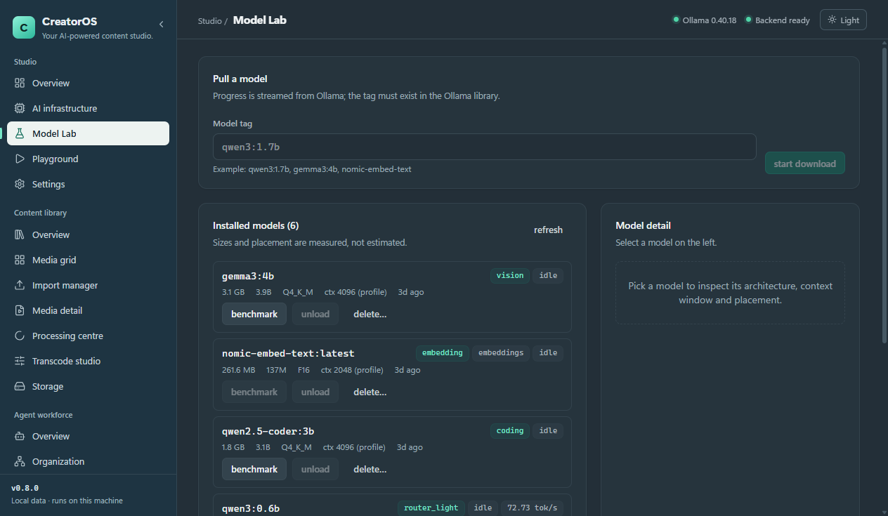
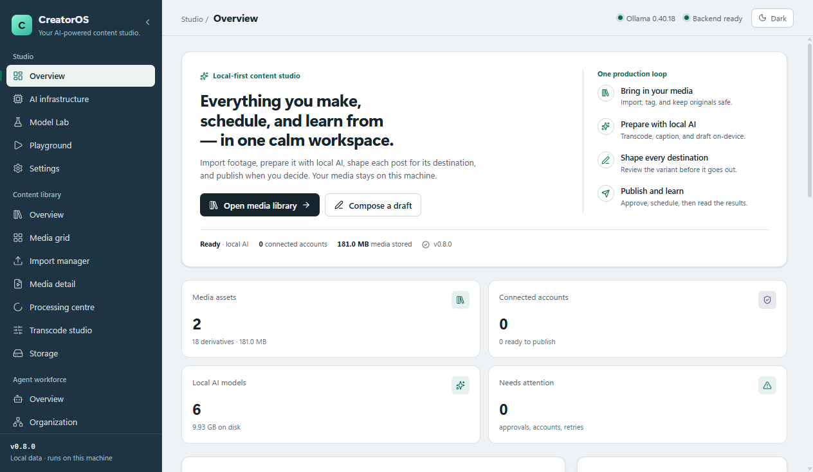

# CreatorOS

**A local-first AI desktop workspace for creating, managing, publishing, and
analyzing social media content.**

[](LICENSE)
[](https://github.com/medltf9-oss/CreatorOS/actions/workflows/ci.yml)
[](#requirements)
[](CHANGELOG.md)

CreatorOS brings a media library, on-device AI, a multi-agent content
workforce, human-approved publishing, and performance analytics into one calm
desktop application. Media, model output, credentials and analytics stay on the
machine unless you explicitly connect a provider and publish.



## What it does

- **Content library.** Content-addressed imports, real ffprobe metadata,
  thumbnails, timeline strips, waveforms, previews, proxies, five transcode
  profiles, durable media jobs and storage management.
- **Local AI.** Ollama-backed model lab, playground, routing profiles, resource
  governor and persisted execution history. Nothing is sent to a cloud model.
- **Agent workforce.** Versioned agent registry, a persistent task DAG,
  hierarchical orchestration, scoped memory and approval-bound tools.
- **Social accounts.** OAuth through loopback callbacks, an encrypted credential
  vault, capability checks and token lifecycle tracking.
- **Publishing.** Compose per-destination variants, validate against platform
  limits, request human approval, schedule, publish, reconcile and retry.
- **Analytics.** Account, publication, content, campaign, video, audience and
  hashtag views backed by synced provider metrics — no synthetic charts.
- **Two themes, one design system.** A graphite-blue dark workspace and a
  cool-neutral light theme, documented in [`docs/DESIGN_SYSTEM.md`](docs/DESIGN_SYSTEM.md).

| Content library | Publishing |
| --- | --- |
|  |  |

| Local AI | Light theme |
| --- | --- |
|  |  |

## Project status

Version 0.8.0 is a **Windows x64** release. The source is complete and tested;
provider integrations require your own developer apps and live accounts. The
application does not include provider credentials, model weights, FFmpeg
binaries, sample media or analytics data.

The project is honest about what has and has not been verified:

- The installer is **not code-signed**. Windows SmartScreen will warn, and
  Smart App Control can refuse to run it. See [`docs/CODE_SIGNING.md`](docs/CODE_SIGNING.md).
- Publishing was verified against the provider contract with test doubles and
  local reconciliation. Live publishing requires provider approval, connected
  accounts and your own apps; see [`docs/LIVE_PROVIDER_VERIFICATION.md`](docs/LIVE_PROVIDER_VERIFICATION.md).
- FFmpeg and Ollama are external prerequisites, not bundled in the repository.
- The release was exercised on the maintainer's Windows machine, including
  install, upgrade, uninstall and production-health checks. It has not been
  certified on every Windows configuration.

## Requirements

- Windows 10/11 x64.
- [Ollama](https://ollama.com/) 0.40 or newer for local AI features.
- FFmpeg/ffprobe 7+ for media processing. Place them under
  `<DATA_ROOT>\tools\ffmpeg\bin` or set `CREATOROS_FFMPEG_DIR`.
- For source development: Git, Node.js 22+ with pnpm 9+, Python 3.12+.

The packaged installer includes its own Python runtime and Node/Electron
runtime. End users do not need Python or Node installed.

## Install a release

There is **no binary attached to the 0.8.0 GitHub release**. The 0.8.0
installer is unsigned, and its acceptance run did not cover a clean Windows 11
machine with Smart App Control enabled. The project therefore publishes this
release as source only; it does not ask you to run a binary whose behaviour on
a default Windows 11 installation it cannot currently verify.

Build from source below. When a signed build is published, the release will
contain `CreatorOS-Setup-<version>.exe` and `SHA256SUMS.txt`, and these steps
will apply:

1. Download `CreatorOS-Setup-<version>.exe` and `SHA256SUMS.txt` from the release.
2. Verify the hash: `Get-FileHash .\CreatorOS-Setup-<version>.exe -Algorithm SHA256`.
3. Run the installer. It installs per-user and creates Desktop and Start Menu
   shortcuts.
4. Start Ollama, then launch CreatorOS.

The tested 0.8.0 installer record is in
[`docs/RELEASE_NOTES_0.8.0.md`](docs/RELEASE_NOTES_0.8.0.md).

Upgrade and removal instructions: [`docs/INSTALLATION.md`](docs/INSTALLATION.md),
[`docs/UPGRADING.md`](docs/UPGRADING.md) and
[`docs/UNINSTALLATION.md`](docs/UNINSTALLATION.md).

### A note on environment variables

Do not launch the installed application with `ELECTRON_RUN_AS_NODE=1`. Some
IDE and automation environments set it globally; Electron then runs as plain
Node and exits without a window. Use the installed shortcut or a shell where
the variable is unset.

## Build from source

```powershell
git clone <your-fork-url> CreatorOS
cd CreatorOS

# Install the renderer dependencies
cd app\desktop
pnpm install

# Create the backend environment
cd ..\backend
python -m venv .venv
.\.venv\Scripts\python -m pip install -e ".[dev]"
```

Create a data root and local configuration. The default is
`%USERPROFILE%\CreatorOS`; a portable source checkout usually points at the
checkout itself:

```powershell
$env:CREATOROS_ROOT = (Resolve-Path .\..\..).Path
powershell -ExecutionPolicy Bypass -File scripts\set_env.ps1 -Root $env:CREATOROS_ROOT -Apply
```

Run the development shell:

```powershell
cd app\desktop
pnpm dev
```

Build the renderer with `pnpm build`. Package the Windows installer with
`pnpm package`; see [`docs/PHASE9_RELEASE.md`](docs/PHASE9_RELEASE.md) for the
signed-release checklist and `scripts/build-release.ps1` for the automated
path.

## Tests and checks

```powershell
# Backend
cd app\backend
.\.venv\Scripts\python -m pytest -q

# Renderer type check, unit tests, production bundle
cd ..\desktop
pnpm typecheck
pnpm test
pnpm build

# Repository health
cd ..\..
powershell -ExecutionPolicy Bypass -File scripts\diagnose.ps1 -Root (Get-Location)
```

The release validation used 1,577 backend tests, 200 desktop tests, a 49-route
dark/light UI audit, TypeScript strict type checking and a production bundle.
See [`docs/PRODUCTION_READINESS.md`](docs/PRODUCTION_READINESS.md) and
[`docs/evidence/`](docs/evidence/) for the measured evidence.

## Architecture

```
app/
  desktop/            Electron main process + React renderer
    electron/         Window, bootstrap, IPC, backend lifecycle
    src/              React pages, components, API clients, design tokens
    tests/            Node test runner suites
  backend/            FastAPI application and worker runtime
    src/creatoros/    API, services, workers, integrations, persistence
    alembic/          Database migrations
    tests/            Pytest suites
  installer/          electron-builder configuration and release metadata
scripts/              Bootstrap, diagnostics, verification and release tooling
docs/                 Architecture, operations, design and evidence
```

The renderer never talks to provider APIs directly. Electron starts the local
FastAPI service on a loopback port with a per-launch token; the renderer calls
that typed API. Provider tokens live in the encrypted vault, not in renderer
storage. Media files are served through signed, expiring URLs.

## Data and privacy

The default data root is `%USERPROFILE%\CreatorOS`. It contains the database,
media originals and derivatives, model weights, logs, backups and encrypted
credentials. Nothing in that directory is intended for source control.

- The app makes no telemetry call.
- Local AI runs through Ollama on `127.0.0.1`.
- Social OAuth uses a loopback callback; no public tunnel is opened.
- Publishing is an explicit, human-approved action.
- Secrets are encrypted at rest with Windows DPAPI-backed key material.

Do not commit `.env` files, `config/secrets/`, databases, media, logs or model
weights. The repository's `.gitignore` covers these paths.

## Contributing

Contributions are welcome under the Apache-2.0 licence. Start with
[`CONTRIBUTING.md`](CONTRIBUTING.md), follow the
[`CODE_OF_CONDUCT.md`](CODE_OF_CONDUCT.md), and read
[`AGENTS.md`](AGENTS.md) if you use an AI coding agent.

- Report security issues privately: [`SECURITY.md`](SECURITY.md).
- Use the issue templates for reproducible bugs and focused feature requests.
- Keep changes covered by tests and preserve the invariants documented in
  [`docs/ADR/`](docs/ADR/).

## Licence

Copyright 2026 CreatorOS contributors.

Licensed under the [Apache License, Version 2.0](LICENSE) (SPDX:
`Apache-2.0`). Third-party components keep their own licences; see
[`NOTICE`](NOTICE) and [`THIRD_PARTY_NOTICES.md`](THIRD_PARTY_NOTICES.md).
The licence does not grant trademark rights in the CreatorOS name or logo.
